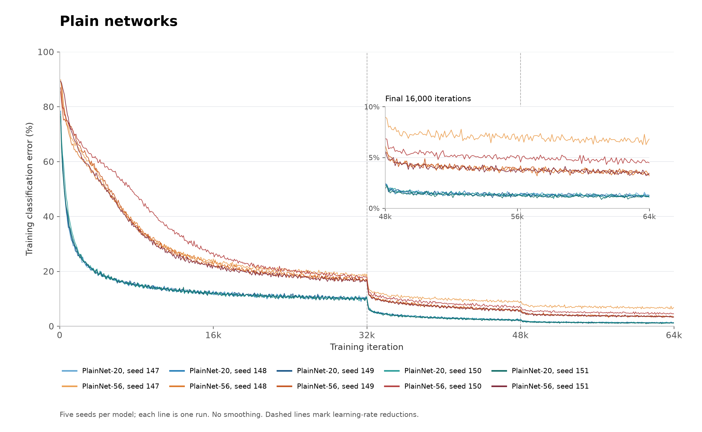
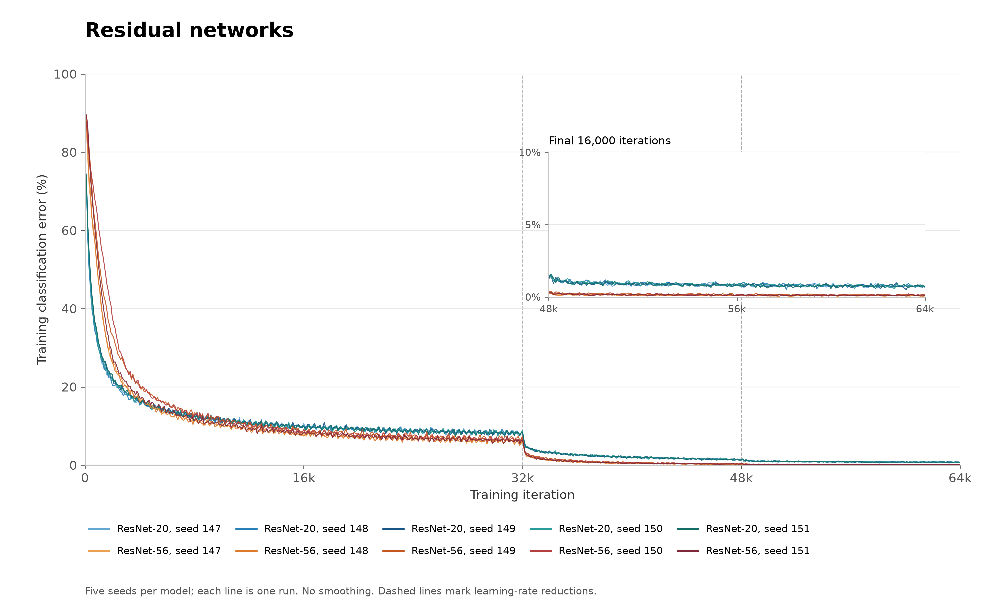

# Deep Residual Learning for Image Recognition

## Reference

- **Paper:** [arXiv:1512.03385v1](https://arxiv.org/abs/1512.03385v1)
- **Authors:** Kaiming He, Xiangyu Zhang, Shaoqing Ren, Jian Sun
- **Published:** arXiv preprint, 2015

## Key Concepts

In 2015 the paper _Deep Residual Learning for Image Recognition_ introduced the concept of "residual learning"
(explained below) to deep learning and demonstrated that it significantly improved the training of very deep networks
on tasks in the computer vision domain.

The paper's central ideas can be summarised as follows:

1. For very deep networks, **training error** was known to increase with network depth. This was not overfitting,
   since **both training error and test error** increase. Moreover, the authors demonstrated constructively that for
   any "shallow" network $N_s$ implementing some function $N (x, \theta)$ there exists a corresponding deeper network
   $N_d$ implementing the same function: deeper network need not inherently perform worse than shallower networks.
   Therefore, the authors hypothesised that the degradation is caused by optimisers being unable to **find** equally
   good parameters for deeper networks within feasible training time.
2. The paper hypothesises that in a deep network, in particular in the context of visual data, **the optimal function
   $H (x)$ to be learned by a small stack of layers is close to the identity function**, i.e. $H (x) \approx x$. If so,
   then the authors hypothesise that it would be easier for the optimiser to learn the **residual function**
   $F (x) = H (x) - x$ than to learn $H (x)$ directly (since $F (x) \approx \vec{0}$). In other words, instead of
   learning
   the full mapping $H (x)$, the stack of layers is defined such that $H (x) = F (x) + x$, where $x$ is provided "as is"
   by a skip connection and only the residual function $F (x)$ is learned. The block implementing $H (x)$ in this manner
   is called a "residual block", and is the key architectural innovation of the paper.

The "residual blocks" introduced in the paper remain a fundamental building block in modern neural network
architectures as of 2026.

## Reproduction Goal

One of the main experimental results of the paper is a comparison of the performance of 20-layer and 56-layer residual
networks (i.e. networks where residual blocks are used) with 20-layer and 56-layer "plain" networks on the CIFAR-10
dataset. The authors' experiment showed the following:

1. The 56-layer plain network has higher training error than the 20-layer plain network (degradation with depth).
2. The 56-layer residual network has lower training error than the 20-layer residual network (no degradation).
3. The residual networks at both depths had lower test classification error than the plain networks at either depth.

The reproduction goal is to replicate this result. I avoided any of the ImageNet experiments from the original paper
since training runs on a single RTX 4070 Super GPU, and training on the full ImageNet dataset might take several days.
I also avoid the 110-layer residual network from the CIFAR-10 experiments since it is not necessary for demonstrating
the key ideas of the paper.

## Implementation

The experiment is replicated in [experiment.ipynb](experiment.ipynb).

The CIFAR-10 dataset is downloaded using `torchvision`. The pre-processing steps from the paper are then applied:

1. Transform to `torch.float32` dtype with pixel values rescaled from `[0, 255]` to `[0, 1]`
2. "Normalise" by subtracting the "mean image" from each individual image (see note below)
3. The training set only has random horizontal flips and random 32x32 crops applied

> [!note]
> The original paper was somewhat vague in describing the "mean image" subtraction. It stated that the "per-pixel
> mean is subtracted from each pixel". It's unclear over which dimensions the average is calculated; in particular,
> it wasn't clear whether the 3 channels are aggregated into a single value for each pixel.
>
> I chose to interpret this as a per-pixel, per-channel average calculated over the entire training set. That is, I
> produce a single "mean image" for the dataset which is a tensor with `torch.Size([3, 32, 32])`. This has the same
> shape as each individual image in the dataset, and its values are averaged across the dataset index dimension. I
> chose this because it seemed like the most "natural" interpretation and aligned with my intuition of how training
> samples are usually normalised. I did **not** compare results across different implementations of this step, so this
> interpretation was not experimentally validated.

The model architectures are implemented "from scratch" using `torch.nn` primitives such as `Conv2d`, `ReLU`,
`BatchNorm2d` and pooling operations. Of particular interest is the residual block implementation (section 2.2. of the
notebook). The implementation matches the description on page [3](https://arxiv.org/pdf/1512.03385v1#page=3) (§3.2) of
the paper,
with the CIFAR-10 architecture described on page [7](https://arxiv.org/pdf/1512.03385v1#page=7) (§4.2).

Each network is trained as per section 4.2. of the paper: SGD with batch size 128, momentum 0.9, weight decay 0.0001,
and an initial learning rate of 0.1. Training lasts for 64,000 iterations, and the learning rate is reduced by a factor
of 10 after 32,000 and 48,000 iterations. Each model is trained with the same 5 fixed seeds and each run is logged
using `wandb`. See section 3 of the notebook for the hyperparameters and training loop.

## Setup

Clone the repo, `make setup`. The repo automatically selects CUDA 13.2 builds of PyTorch and
torchvision on Windows and Linux. Authenticate with `uv run wandb login` before running the experiment.

## Running

Start the Jupyter server with `uv run jupyter lab`, then run the [experiment.ipynb](experiment.ipynb) notebook.

## Results

The table below summarises the experiment results (mean + sample std.dev. across the 5 seeded runs). The final training
error reported here is evaluated using the training set but **without augmentation** (flips/crops disabled).

| Model       | Training error (%) | Test error (%) | Paper test error (%) |
|-------------|-------------------:|---------------:|---------------------:|
| PlainNet-20 |        0.55 ± 0.04 |    9.36 ± 0.24 |                    — |
| ResNet-20   |        0.30 ± 0.02 |    8.41 ± 0.19 |                 8.75 |
| PlainNet-56 |        2.84 ± 1.30 |   12.50 ± 0.59 |                    — |
| ResNet-56   |        0.02 ± 0.01 |    7.14 ± 0.48 |                 6.97 |

The paper's values are from [Table 6](https://arxiv.org/pdf/1512.03385v1#page=7). The paper didn't tabulate the test
error for PlainNet-20 and PlainNet-56 (they are only displayed as curves), so I didn't include them above.

The training error across all 20 runs are plotted below. Each line is one run, with each point reporting error over the
preceding 100 training iterations.
The insets show the final 16,000 iterations to better highlight the difference between the PlainNet and ResNet learning
curves at the end of training. Note that the training error in this view is evaluated directly on the training set's
augmented batches (flips/crops enabled):

<table>
  <tr>
    <td width="50%">
      
    </td>
    <td width="50%">
      
    </td>
  </tr>
</table>

(Click either plot to view it at full resolution.)

These plots were generated by exporting the runs' values from Weights and Biases to `results/wandb-training-error.csv`,
then having Codex re-plot it locally (see `results/plot_training_error.py`) as I wasn't satisfied with the visuals of
the W&B plots themselves.

## Conclusion

This exercise has successfully reproduced the three outcomes from the [reproduction goal](#reproduction-goal). The
test error for the ResNet-20 and ResNet-56 architectures is close to the values from the paper. For example, for
ResNet-56 the paper's test error falls within one sample standard deviation of the five-run mean (this alone
does not establish statistical equivalence, of course). The learning curves display the same qualitative behaviour as 
in the paper. Together with the final metrics, they show the following:

1. PlainNet's training error increases when network depth is increased from 20 to 56
2. ResNet's training error does not increase when network depth is increased from 20 to 56 (in fact, it decreases)
3. The residual networks at both depths have lower test classification error than the plain networks at either depth

Empirically this supports the conclusions made by the paper. My limited reproduction does not touch some
of the other questions tackled by the paper, such as whether there is a limit to how deep a ResNet can effectively be 
and whether the result generalises to other image tasks.